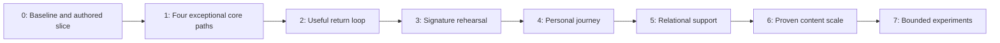

# Innerverse — Beads roadmap guide

Updated: 2026-10-04. Companion to [80-20-plan.md](80-20-plan.md). This document locates issues and explains workflow; current statuses and evidence live in Beads.

## Tracker configuration

- Upstream: [gastownhall/beads](https://github.com/gastownhall/beads).
- CLI verified in this workspace: `bd` version `1.3.1`; binary `/workspace/tools/bd`, exposed through `~/.local/bin/bd`.
- Existing repository initialization, history, and issue prefix `ArchetypeAI` are retained. Do not run a fresh `bd init` over the existing tracker.
- Storage: embedded Dolt at `.beads/embeddeddolt`; project metadata is in `.beads/metadata.json`.
- Data synchronization: `git+https://github.com/shapefuture/ArchetypeAI.git`, separate `refs/dolt/data`. Code branches and tracker data are distinct.
- `.beads/issues.jsonl` is a passive export and may lag; do not use it as a second status database or routinely import it.

Root roadmap epic: **`ArchetypeAI-28h`**. Planning/setup is tracked separately as `ArchetypeAI-j3b`; assessment-methodology audit as `ArchetypeAI-28h.9`. Completing either does not complete an app feature. Sections 12 and 19 of the plan cover user-controlled evidence memory, assessment-methodology findings, and reconciliation decisions.

The implementation roadmap comprises 70 implementation tasks, eight stage epics, eight acceptance milestones, and one root epic. It has 243 explicit blocking dependencies in addition to hierarchy and related-work links. Every task has scope, an implementation-guide reference, and acceptance criteria. No speculative app implementation has been marked complete.

## Stage navigation

| Stage | Epic | Acceptance gate | Implementation tasks | Guide |
|---|---|---|---:|---|
| 0. baseline, service contracts, and authored core slice | `ArchetypeAI-28h.1` | `ArchetypeAI-28h.1.7` | 7 | [Section 8](80-20-plan.md) |
| 1. exceptional assessment, map, coach, and booking | `ArchetypeAI-28h.2` | `ArchetypeAI-28h.2.19` | 30 | [Section 9](80-20-plan.md) |
| 2. useful return loop and meaningful progression | `ArchetypeAI-28h.3` | `ArchetypeAI-28h.3.6` | 5 | [Section 10](80-20-plan.md) |
| 3. authored Replay, Director, and inner negotiation | `ArchetypeAI-28h.4` | `ArchetypeAI-28h.4.5` | 4 | [Section 11](80-20-plan.md) |
| 4. inspectable personal journey and voluntary seasons | `ArchetypeAI-28h.5` | `ArchetypeAI-28h.5.5` | 6 | [Section 12](80-20-plan.md) |
| 5. consensual relational support | `ArchetypeAI-28h.6` | `ArchetypeAI-28h.6.5` | 4 | [Section 13](80-20-plan.md) |
| 6. reviewed content scale and production grammar | `ArchetypeAI-28h.7` | `ArchetypeAI-28h.7.5` | 7 | [Section 14](80-20-plan.md) |
| 7. individually evaluated experimental extensions | `ArchetypeAI-28h.8` | `ArchetypeAI-28h.8.8` | 7 | [Section 15](80-20-plan.md) |



Each arrow means the previous acceptance decision blocks later implementation. Within a stage, dependencies express real prerequisites; independent ready work can proceed together. Parent/child relationships alone do not certify completion. Early research sketches are allowed by the plan but do not unlock production implementation gates.

## Task index

This is a navigation index, not a completion checklist. Inspect each issue for full scope, criteria, blockers, and evidence.

### Stage 0: baseline, service contracts, and authored core slice

| Bead | Scope |
|---|---|
| `ArchetypeAI-28h.1.1` | Capture four core journeys and canonical/historical data baseline |
| `ArchetypeAI-28h.1.2` | Inspect configured support services, roles, entitlements and time contracts |
| `ArchetypeAI-28h.1.3` | Capture and preserve React and Angular loading-screen identity |
| `ArchetypeAI-28h.1.4` | Measure real-device performance and critical accessibility baseline |
| `ArchetypeAI-28h.1.5` | Approve authored world, tactile tokens, and end-to-end reference frames |
| `ArchetypeAI-28h.1.6` | Validate independent sensory controls and unprompted intuitiveness |
| `ArchetypeAI-28h.1.8` | Review assessment constructs, item confounds and source limitations |

Stage 0 evidence artifacts: [core journeys and data](baseline/core-journeys-and-data.md), [service capabilities and contracts](baseline/service-capabilities-and-contracts.md), [loading identity reference](baseline/loading-identity-reference.md), [device/accessibility baseline](baseline/device-performance-accessibility.md), [assessment construct review](baseline/assessment-construct-review.md), and the proposed [authored-world reference slice](baseline/authored-world-reference-slice.md). The reference slice is a design direction, not validated user research or shipped behavior. The evidence artifacts identify missing production, preview, emulator, account, physical-device, and participant evidence explicitly; they do not claim a live walkthrough or empirical assessment validation.

### Stage 1: exceptional assessment, map, coach, and booking

| Bead | Scope |
|---|---|
| `ArchetypeAI-28h.2.1` | Preserve authored loading while replacing fixed wait with real readiness |
| `ArchetypeAI-28h.2.2` | Implement persistent sensory preferences and scene attention coordination |
| `ArchetypeAI-28h.2.3` | Unify intuitive navigation, responsive layouts and focus continuity |
| `ArchetypeAI-28h.2.4` | Clarify assessment routes and repair misleading seeded profiles |
| `ArchetypeAI-28h.2.5` | Make assessment answers durable and interrupted use recoverable |
| `ArchetypeAI-28h.2.6` | Create credible layered reports and consent-aware next actions |
| `ArchetypeAI-28h.2.7` | Preserve Felt identity and distinguish coordinates from presentation |
| `ArchetypeAI-28h.2.8` | Build legible map selection, relationships and contextual detail |
| `ArchetypeAI-28h.2.9` | Complete accessible map alternatives and graphics lifecycle recovery |
| `ArchetypeAI-28h.2.10` | Author core interaction states and a small original delight catalogue |
| `ArchetypeAI-28h.2.11` | Implement visible bounded consent/context handoff |
| `ArchetypeAI-28h.2.12` | Complete genuine coach request, cancellation and recovery states |
| `ArchetypeAI-28h.2.13` | Review coach usefulness, retained artifacts and conversational boundaries |
| `ArchetypeAI-28h.2.14` | Specify and implement versioned timezone and legacy booking contract |
| `ArchetypeAI-28h.2.15` | Complete real availability, booking confirmation and failure recovery |
| `ArchetypeAI-28h.2.16` | Verify redesigned booking with real accounts and adverse time cases |
| `ArchetypeAI-28h.2.17` | Verify real auth, coach access and declared entitlement scope |
| `ArchetypeAI-28h.2.18` | Finish bilingual, sensory, accessibility, real-device and intuitive core acceptance |
| `ArchetypeAI-28h.2.20` | Authorize complete therapist client-map workspace and read-only ownership |
| `ArchetypeAI-28h.2.21` | Preserve exact four coordinates and complete 3+1-axis analytical controls |
| `ArchetypeAI-28h.2.22` | Inspect therapist relationships, full-vector pair comparison and score overlays |
| `ArchetypeAI-28h.2.23` | Separate reference placement, personalized scores and historical therapist notes |
| `ArchetypeAI-28h.2.24` | Validate real therapist 3+1 analysis and plush-cosmos visual grammar |
| `ArchetypeAI-28h.2.25` | Harden assessment numeric boundaries and reproducible version contracts |
| `ArchetypeAI-28h.2.26` | Correct provisional, relative, reference and single-item score presentation |
| `ArchetypeAI-28h.2.27` | Allow low-evidence and ambiguous assessment interpretations without forced identities |
| `ArchetypeAI-28h.2.28` | Review developmental, attachment, crisis and relationship inference claims |
| `ArchetypeAI-28h.2.29` | Preserve bipolar coexistence, contextual interpretation and analytical identity |
| `ArchetypeAI-28h.2.30` | Reconcile 64 and 147 through provenance-aware claims and disagreement |
| `ArchetypeAI-28h.2.31` | Deliver a bounded, correction-first situation inquiry |

### Stage 2: useful return loop and meaningful progression

| Bead | Scope |
|---|---|
| `ArchetypeAI-28h.3.1` | Connect contextual check-in and reviewed practices without irrelevant gates |
| `ArchetypeAI-28h.3.2` | Create editable if-then experiment cards and Repair/resource flow |
| `ArchetypeAI-28h.3.3` | Add recall-first review, boundary probes and environmental alternatives |
| `ArchetypeAI-28h.3.4` | Implement artifact-based progression and chosen workshop rewards |
| `ArchetypeAI-28h.3.5` | Evaluate multi-use return loop and opt-in reminder lifecycle |

### Stage 3: authored Replay, Director, and inner negotiation

| Bead | Scope |
|---|---|
| `ArchetypeAI-28h.4.1` | Author one bounded everyday Replay and editable personal cast |
| `ArchetypeAI-28h.4.2` | Build Watch and Director with meaningful constrained interactions |
| `ArchetypeAI-28h.4.3` | Add inner negotiation, possibility wardrobe and experiment handoff |
| `ArchetypeAI-28h.4.4` | Compare Replay against guided text with accessible parity |

### Stage 4: inspectable personal journey and voluntary seasons

| Bead | Scope |
|---|---|
| `ArchetypeAI-28h.5.1` | Define inspectable personal-memory provenance and deletion propagation |
| `ArchetypeAI-28h.5.2` | Create source-linked episodes and controlled perspective postcards |
| `ArchetypeAI-28h.5.3` | Build optional practice palette, flexible season and creative endpoints |
| `ArchetypeAI-28h.5.4` | Deliver Quiet mode, graduation and longitudinal continuity evaluation |
| `ArchetypeAI-28h.5.6` | Create a user-controlled personal evidence library |
| `ArchetypeAI-28h.5.7` | Enable user-directed AI edits to personal part memory |

### Stage 5: consensual relational support

| Bead | Scope |
|---|---|
| `ArchetypeAI-28h.6.1` | Build recipient-specific Self.FAQ with honest disclosure and revocation |
| `ArchetypeAI-28h.6.2` | Prototype jointly editable support experiments and Loop Finder |
| `ArchetypeAI-28h.6.3` | Verify consent withdrawal, role changes and solo-path parity |
| `ArchetypeAI-28h.6.4` | Specify qualified facilitated practice and reviewed contribution boundaries |

### Stage 6: reviewed content scale and production grammar

| Bead | Scope |
|---|---|
| `ArchetypeAI-28h.7.1` | Extract reviewed scene grammar and validation from proven manual units |
| `ArchetypeAI-28h.7.2` | Build reviewed content editor and reusable authored asset/rig system |
| `ArchetypeAI-28h.7.3` | Implement eligible bounded AI suggestions and content evidence register |
| `ArchetypeAI-28h.7.4` | Complete localized content versions, durability and performance acceptance |
| `ArchetypeAI-28h.7.6` | Design consented joint/paired calibration with adequate data and sampling |
| `ArchetypeAI-28h.7.7` | Evaluate structure, reliability, fairness, validity and crosswalk uncertainty |
| `ArchetypeAI-28h.7.8` | Prototype a versioned modular battery only after calibration evidence |

### Stage 7: individually evaluated experimental extensions

| Bead | Scope |
|---|---|
| `ArchetypeAI-28h.8.1` | Research rehearsing tomorrow versus a simple preparation checklist |
| `ArchetypeAI-28h.8.2` | Research a permissioned shared conversation room |
| `ArchetypeAI-28h.8.3` | Research deliberately user-authored contextual cues |
| `ArchetypeAI-28h.8.4` | Research qualified advanced facilitated labs |
| `ArchetypeAI-28h.8.5` | Research optional cultural/lineage meaning lenses |
| `ArchetypeAI-28h.8.6` | Evaluate one genuinely useful XR task on real hardware |
| `ArchetypeAI-28h.8.7` | Evaluate consent-aware distribution after demonstrated product value |

## Existing work preserved and linked

- `ArchetypeAI-hi8`: Angular-to-React parity epic, related to the new roadmap. Its historical implementation and live release acceptance are distinct.
- `ArchetypeAI-hi8.5`: outstanding parity live/manual/device release sign-off, related to core acceptance. XR/push checks are not universal prerequisites for the four core paths, and remain independently open where unverified.
- `ArchetypeAI-8nz`: existing real client/practitioner booking verification, reused as a prerequisite of the new booking acceptance task.
- `ArchetypeAI-a1v`: existing configured Stripe-secret/access follow-up, related to access acceptance; whether checkout is a core gate follows the actually required entitlement scope.
- `ArchetypeAI-h8c`: existing device/background push work, related to return-loop reminders. A visual reminder or service-worker build does not verify delivery.

## Day-to-day commands

Run from the repository root. These commands were checked against the installed CLI; inspect command help if upgrading Beads.

```bash
bd dolt pull
bd ready --label roadmap --type task
bd show ArchetypeAI-28h.1.1
bd update ArchetypeAI-28h.1.1 --claim
bd update ArchetypeAI-28h.1.1 --append-notes "Evidence: commit, environment, fixture, observation, limitations."
bd close ArchetypeAI-28h.1.1 --reason "Specific acceptance criteria passed; evidence attached."
bd dep cycles
bd dolt push
```

The claim/update/close lines illustrate the workflow; they are not instructions to close an untested baseline. Keep meaningful acceptance evidence in the issue. To create follow-up work, use `bd create` with a parent, scope, criteria, and real prerequisite dependencies.

Inspect a stage or the whole roadmap:

```bash
bd graph ArchetypeAI-28h.2 --compact
bd graph ArchetypeAI-28h --open
bd ready --label roadmap --type task --explain
```

The root may exceed the terminal graph row limit as the roadmap grows; use a stage graph or the CLI limit option described by `bd graph --help`. For an optional local interactive visualization, generate a stage graph with `bd graph ArchetypeAI-28h.2 --html > /tmp/innerverse-core-progress.html`. It is a derived snapshot; regenerate rather than editing it as a tracker.

## Current execution state

Source-based artifacts now cover journey/data contracts, support-service boundaries, the loading identity, device/accessibility constraints, and assessment-item hypotheses. No production or preview session, Firebase emulator, real account, live appointment, physical-device run, participant interview, or psychometric validation was performed. Beads remains the status and acceptance record; later tasks must gather the runtime and research evidence required by their own criteria rather than treating source inspection as a successful user journey or validation study.

## Installation and remote recovery

On a different machine, install the official Beads CLI using [upstream installation guidance](https://github.com/gastownhall/beads#-quick-start), ensure `bd` is on PATH, clone this repository, and read `AGENTS.md` plus `bd prime`. Follow the upstream restoration guidance for the existing project and pull its Dolt data; preserve the configured database identity/history. Do not overwrite it by treating JSONL as the wire format.

Normal sync is `bd dolt pull` / `bd dolt push`. If authenticated Git reads work but Git transport writes fail while GitHub API writes are authorized, preserve the pending transport commit and publish its exact blob/tree objects and data ref through that API, with a non-force update and parent/tree verification. This recovery must operate on `refs/dolt/data`, not a code branch or an issue-export replacement. Never put tokens or credential values into task notes or diagnostics.

## Completion protocol

After a task, attach evidence, close only the accepted work, and create remaining issues. Commit/push application or documentation changes normally, then sync Beads separately and verify the remote state. An accepted stage gate records what passed and what remains outside scope. A research gate can record a justified stop decision; it does not imply all speculative features shipped.
