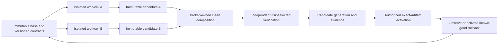

# AAA v7.1 architecture adoption and parallel agent sweeps

Prepared 2026-10-06. Architecture root: `ArchetypeAI-n0h`. Product root: `ArchetypeAI-d6d`.

Source: [AAA-V7-SPEC.md](https://github.com/shapefuture/AAA-Architecture/blob/main/AAA-V7-SPEC.md); it declares **Antifragile Adaptive Architecture v7.1.0, draft normative**, despite the filename. Pinned SHA256: `e85d85f962c8da8ed110122b4fa236f934b16cdbbc9108f80ca2f32b50be75dc`. [The exact source snapshot](references/AAA-V7-SPEC.source.md) is preserved unchanged so agents can review the same input if upstream changes.

The adoption goal is faster independent development with explicit ownership, evidence and recovery. Start from the existing monolith/deployables and make contracts and integration dependable. The minimum profile can be implemented by repository scripts and CI; the five required logical development services do not imply five deployed servers.

This is an adoption plan. It does not establish AAA conformance, an operational workcell runner, active leases, implemented architecture gates or a production generation manager.

## Observed starting point

- React/Vite is the active product surface under `src/parts-cartographer/**`; the retained Angular surface is `src/app/**`; server-side routing/security lives in `worker.ts`, `worker-security.ts` and `worker-helpers.ts`.
- React `core/ports.ts` and Angular `core/ports/ai.port.ts` expose different model interfaces. The Angular contract contains framework/provider coupling; React app wiring imports concrete adapters. Contract, framework token, bridge and composition responsibilities need explicit separation.
- Large shared surfaces include `app.jsx`, `overlays.jsx`, `practice.jsx`, `innerverse.jsx`, locale resources, root package files and one broad browser parity suite. These are integration ownership hotspots.
- Local storage, Firestore/server authority and rebuildable presentation projections coexist. Declare their ownership and acknowledgement separately rather than assuming one state strategy.
- Current CI already performs type checking, units, Firestore emulator gates, browser parity and both builds. Extend this pipeline.
- The existing build stamp includes wall-clock identity. It is useful recorded evidence, but a reproducible full generation needs source/artifact/lock/config/schema/policy/component/binding/evidence identity.
- Existing application changes are uncommitted in the current checkout. First reconcile them into a reviewable immutable implementation baseline; a documentation-only HEAD is insufficient as the source identity of the observed app.

## Adoption scope and normative traceability

| AAA requirement | Proposed app-scale mechanism | Status of requirement |
| --- | --- | --- |
| Constitution and authority ceiling, §§5–6 | Small invariant registry; capability rules; protected-policy change path. | Mandatory foundation; candidate proposals cannot activate themselves. |
| Immutable generations, §7 | Full manifest and content hashes; exact tested-artifact activation; known ancestor retention. | Mandatory generation identity and activation semantics. |
| Authoritative state and control journal, §10 | Explicit local/server/derived ownership; append-only or tamper-evident deployment/incident journal. | Mandatory declarations and control journal; event sourcing is optional. |
| Development fabric, §11A | Beads workplan compiler, isolated workcell runner, contract registry, broker, independent verifier. | Five mandatory logical services. |
| Conflict-aware parallelism, §11B | Predecessor DAG plus symmetric read/write/slot/contract conflict analysis and leases. | Mandatory conflict graph; branches alone are insufficient isolation. |
| Slots and composition, §11C | Versioned narrow ports, adapters/bridges and explicit per-deployable binding roots. | Mandatory contract-bound swappability and attributable bindings. |
| Fleet integration, §11D | Immutable cell outputs; clean broker composition; rejection gates; verifier-owned evidence. | Mandatory integration transaction. |
| Effects, §9 | E0–E5 operation inventory and domain-specific retry/fencing/compensation. | All state/external operation classification is SHOULD; E4/E5 identity is MUST where external systems permit it. |
| Domain isolation, §11 | Pure scoring, projection, consent and transition logic behind ports. | SHOULD in the source; part of minimal adoption and proposed local fitness gates. |
| Architecture fitness, §19 | Executable dependency, authority, contract, state, lease and evidence checks where practical. | Mandatory executable conformance rules where practical. |
| Risk and verification, §§20–24 | Mutation/risk classification and necessary gate selection; protected evaluator/authority changes are M4/R4. | Ordinary local checks differ from privacy/security/state/governance gates. |
| Exact deployment and rollback, §§25–26 | Activate the tested artifact; rehearse known-generation rollback and effect-aware recovery. | Mandatory activation identity and declared rollback. |
| Optional runtime profiles, §§14–18, 27–29 | Adopt only a demonstrated need with declared profile and additional evidence. | No automatic requirement for microservices, Kubernetes, CRDTs or self-improvement. |

Logical authority separation can be implemented within one program where risk permits it. For R3/R4, producer, evaluator, deployer and evidence authority must be independently controllable (§6.2). An independent verifier gets immutable candidate inputs and its own evidence outputs; it does not edit the implementation it is judging.

## Runtime model scope

- Deterministic application domains and the development fabric use the minimum non-agentic core profile.
- Existing live model/coach calls require a narrowly declared **AG1** runtime scope when enabled: model/tool capabilities, journal, context provenance and effect-appropriate sandbox. Calling the entire model-enabled product AG0 would be inaccurate.
- User-authored notes and specifically requested reversible part edits do not automatically mean persistent model learning. If model experiences become trusted persistent heuristics/skills, classify and satisfy **AG2** promotion, quarantine, provenance, poisoning and rollback requirements.
- **AG3/AG4 remain disabled** under this adoption. Parallel coding agents do not require runtime harness self-improvement. Any later adoption has separate source-defined authority, independent evidence and bounded-execution requirements.

## Architecture packages and small steps

| Package | Responsibility | Source sections | Step range |
| --- | --- | --- | --- |
| `ArchetypeAI-dckg` | Scope, inventory and immutable baseline | §1–3, §7, §44 | `ArchetypeAI-9ulr` → `ArchetypeAI-292r` |
| `ArchetypeAI-a09p` | Constitution, authority and risk | §5–6, §20–22, §4.1 | `ArchetypeAI-znk3` → `ArchetypeAI-ayt6` |
| `ArchetypeAI-70fi` | Beads workplan and conflict compiler | §11A–11B, §42 | `ArchetypeAI-ajtu` → `ArchetypeAI-z4b5` |
| `ArchetypeAI-1sc0` | Isolated workcells and leases | §11A.2–11A.3, §11B | `ArchetypeAI-69s2` → `ArchetypeAI-4eqp` |
| `ArchetypeAI-b9hv` | Contract registry, slots and composition | §11C, §8, §11B.2 | `ArchetypeAI-g010` → `ArchetypeAI-wcfj` |
| `ArchetypeAI-9b2o` | Domain seams and shared-file extraction | §11, §11C, §19 | `ArchetypeAI-mm1r` → `ArchetypeAI-1ndf` |
| `ArchetypeAI-m45b` | Authoritative state, typed effects and recovery | §9–10, §12–13, §26 | `ArchetypeAI-0vwc` → `ArchetypeAI-voe6` |
| `ArchetypeAI-gx64` | Generations, reproducibility and control journal | §7, §10.1, §24–26 | `ArchetypeAI-nz8e` → `ArchetypeAI-n9ad` |
| `ArchetypeAI-6k16` | Integration broker and candidate transactions | §11D, §11B.1–11B.2 | `ArchetypeAI-1m9y` → `ArchetypeAI-kgob` |
| `ArchetypeAI-n4li` | Independent verification and architecture fitness | §6.2, §19, §21–24 | `ArchetypeAI-px1i` → `ArchetypeAI-q349` |
| `ArchetypeAI-efer` | Scoped model runtime and memory promotion | §29, §35, §6, §9 | `ArchetypeAI-pnrr` → `ArchetypeAI-pq9b` |
| `ArchetypeAI-3mqv` | Parallel pilots and architecture value | §11A–11D, P4, P11–P13 | `ArchetypeAI-ipbk` → `ArchetypeAI-wrh9` |

Each package has eight separately claimable tasks. For example, workcells progress through isolation specification, runner construction, independent resources, leases, write rejection, immutable outputs, failure rehearsal and independent acceptance. Generation work separately defines manifests, deterministic identity, builds, journal, exact activation, rollback rehearsal, tamper/substitution tests and operational acceptance.

## Ten independently migratable slots

Each slot has eight tasks: existing implementation/state/effect inventory; proposed versioned contract; six-dimension compatibility suite; pure port/composition; consumer bridges; adapter swap/state/failure proof; independent evidence; authorized frozen-registry publication.

| Slot stream | Logical slot | Migration purpose | Publication |
| --- | --- | --- | --- |
| `ArchetypeAI-zzmm` | `auth.identity` | Auth identity and account lifecycle | `ArchetypeAI-7253` |
| `ArchetypeAI-j60z` | `storage.local` | Local authoritative storage and backup | `ArchetypeAI-kdie` |
| `ArchetypeAI-pb7n` | `assessment.scorer` | Canonical 64/147 scoring and provenance | `ArchetypeAI-7bqb` |
| `ArchetypeAI-ru2y` | `map.projection` | Exact coordinate projection and comparison | `ArchetypeAI-2ey7` |
| `ArchetypeAI-25dd` | `map.renderer` | Felt scene lifecycle and graphics-independent alternative | `ArchetypeAI-02oh` |
| `ArchetypeAI-i3gc` | `coach.transport` | Coach transport, context and cancellation | `ArchetypeAI-oqks` |
| `ArchetypeAI-i3um` | `booking.gateway` | Booking authority and timezone transitions | `ArchetypeAI-15xt` |
| `ArchetypeAI-v2tj` | `consent.provenance` | Consent, source lineage and corrections | `ArchetypeAI-9q4d` |
| `ArchetypeAI-ohi8` | `artifacts.export` | Selected artifact export and local document generation | `ArchetypeAI-e5ww` |
| `ArchetypeAI-npy2` | `entitlement.authority` | Server-verified entitlement and billing authority | `ArchetypeAI-e4h3` |

Compatibility must cover **interface, state, effects, operations, performance and failure semantics**. A method-signature match does not establish substitutability. The original contract remains immutable; version changes fan out to producer, React/Angular consumers, applicable worker consumers and state/schema migrations.

Per-slot publication unblocks that slot's consumers. The aggregate slot milestone is overall acceptance, not a blocker for unrelated product work. Existing divergent APIs receive explicit bridges rather than being declared interchangeable without evidence.

## Proposed module boundaries

The exact file layout is ratified during inventory/contract work. Suggested logical ownership is:

```text
domain:         scoring, inquiry, coordinate math, experiment transitions,
                correction/provenance, consent and timezone rules
ports:          versioned logical contracts without framework/provider imports
adapters:       local store, Firebase/auth, worker/model, renderer, exports
features:       bounded user interactions consuming contracts/domain results
runtime:        operation lifecycle, navigation and effect coordination
composition:    per-deployable logical-slot → implementation binding
architecture:   invariants, registry, workcell policies, generation/evidence
```

Shared locale assembly, package/lockfiles, worker dispatch, rules, build configuration, integration fixtures and app composition are broker/integration-owner writes. Feature cells publish narrow artifacts and wiring requests. Future path proposals in metadata are not a claim that those modules exist today.

## Isolated workcell contract

Before dispatch, resolve this proposed structure into real values:

```yaml
workcell:
  task_node: <actual Bead ID>
  base_generation: <immutable reconciled source/build manifest>
  principals: [<assigned agent or fleet>]
  read_set: [<exact source paths pinned to the base>]
  write_set: [<narrow candidate-owned paths>]
  owned_slots: [<logical slot leases>]
  contracts: [<published immutable versions>]
  capabilities: [repo.read, tests.execute, artifact.publish:candidate]
  forbidden: [active_generation.write, evidence_root.write, other_workcell.write]
  resources:
    checkout: <isolated mutable checkout>
    dependencies_and_outputs: <private or immutable content-addressed resources>
    fixture_database: <private namespace>
    ports: <reserved cell-specific ports>
  outputs: [candidate, change_manifest, local_claimed_checks, handoff]
```

Two workers must not share a mutable checkout, fixture schema, generated cache, build output or integration environment (§11A.3). Read-only immutable inputs and semantically immutable content-addressed caches can be shared. Candidate alternatives for the same slot remain separate until explicit comparison/integration.

Leases identify owner, scope, epoch, expiry, renewal and crash recovery. They must fence stale workers and undeclared writes. A branch name or an informal file assignment is insufficient.

## Dependency and conflict semantics

Beads blocker edges say “this task needs that output.” Proposed symmetric conflicts say “these writes/slots cannot be owned concurrently.” Keep these structures separate. Adding both directions of a conflict as blockers would create a deadlock.

The scheduler derives an eligible antichain after checking predecessors, actual read/write sets, leases, immutable-read allowances, contract transitions and available execution resources. The checked-in conflict snapshot is conservative input; the implemented compiler must recompute it from narrowed actual manifests.

Sweeps below are handoff packages. Ready leaf tasks may be prepared/advanced as their actual prerequisites permit; labels are not hidden launch restrictions. In particular, S1 accepts registry/binding foundations through A05.05; individual frozen C-slot releases belong to S2. This prevents a sweep barrier from waiting on work it has forbidden to start.

## Seven coordinated sweeps

| Sweep | Focus | Three coordination tasks |
| --- | --- | --- |
| `ArchetypeAI-peek` | Discover and freeze the baseline | `ArchetypeAI-hjq1` → `ArchetypeAI-h987` |
| `ArchetypeAI-jtpd` | Build the development substrate | `ArchetypeAI-gbad` → `ArchetypeAI-2i39` |
| `ArchetypeAI-wzvd` | Extract seams and prove integration | `ArchetypeAI-ol81` → `ArchetypeAI-a5oj` |
| `ArchetypeAI-fqvk` | Compose first-use and core reliability | `ArchetypeAI-9jzg` → `ArchetypeAI-1261` |
| `ArchetypeAI-jzbh` | Compose return, play and human continuity | `ArchetypeAI-645d` → `ArchetypeAI-i3t6` |
| `ArchetypeAI-g9aq` | Independent evaluation and extension experiments | `ArchetypeAI-os8w` → `ArchetypeAI-f4hq` |
| `ArchetypeAI-brgs` | Accept, activate and continue from evidence | `ArchetypeAI-1w39` → `ArchetypeAI-gxfm` |

The three tasks compile the eligible antichain/leases, collect and integrate immutable outputs, and independently verify the handoff/new base. They coordinate actual leaf work rather than replace it. A sweep declares finite scope and operational limits; continuing development launches another measured sweep from accepted evidence.



## Integration rejection rules

The broker rejects undeclared/overlapping writes, stale assumptions about changed contracts, hidden concrete-component dependencies, missing contracts, authority expansion, incompatible state ownership, non-reproducible outputs and unsupported candidate-only evidence. It preserves unaffected verified work and invalidates only the causally implicated downstream cone.

A clean verifier reruns the applicable gates. Builders' logs are inputs, not independently owned acceptance evidence. The activator uses the exact tested artifact. Control-journal events retain generation, configuration/policy/evaluator versions, evidence roots, activation, rollback and incidents.

## Risk-selected verification and explicit governance

- R0/R1: meaningful local/static/contract/regression checks according to actual change.
- R2: applicable persistent-state migration/replay and integration evidence.
- R3: independent evaluation, source-required staging/canary and rollback/baseline; account/privacy/external-effect evidence.
- R4: source-required explicit approval, independently controlled evidence and model/formal assurance where feasible.

Active evaluator, promotion policy, authority or constitutional changes are M4/R4 governed transactions. The planning task and candidate code proposal do not supply their activation approval. A protected mechanism cannot rewrite the evidence used to judge itself.

The planned risk selector maps component consequences, mutation and effect semantics to the highest applicable risk; it must not compare unrelated enum ordinals as if E4 and R4 meant the same thing. Every concrete dispatch refines the proposal's classification and authority scope.

## Adoption proof and continuing improvements

The architecture pilot proves disjoint-cell isolation, unsafe-overlap rejection, versioned contract fanout, competing-candidate selection, stale-base rejection and attributable integration. Measure queue wait, conflict rate, integration failures, fanout cost and time to accepted change. Retain machinery whose isolation, correctness or development benefit is demonstrated; simplify mechanisms that add cost without useful marginal value.

Conformance requires implemented mechanisms and actual evidence. Planned folders, manifests or a numerical architecture rating are insufficient. The product continues toward its user outcomes through the linked [detailed feature plan](first-principles-elevation-beads.md), with Beads as live task authority.
