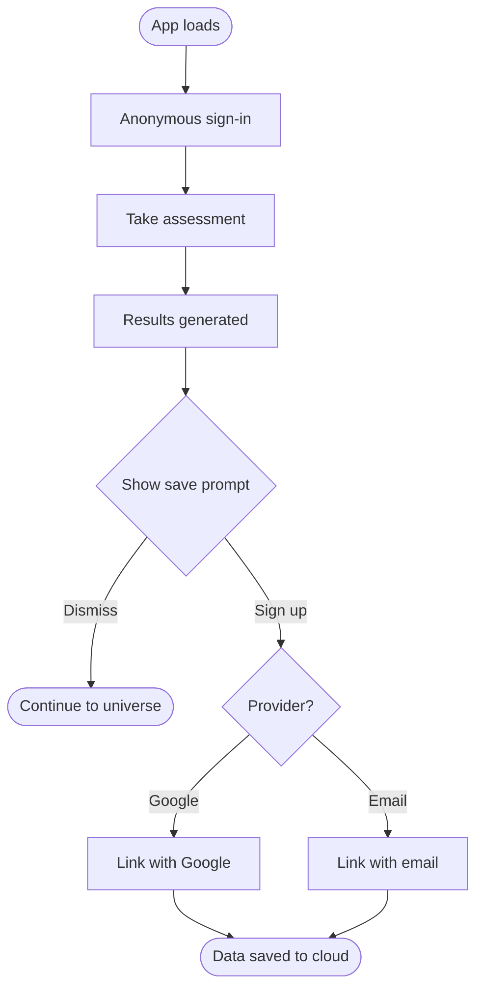
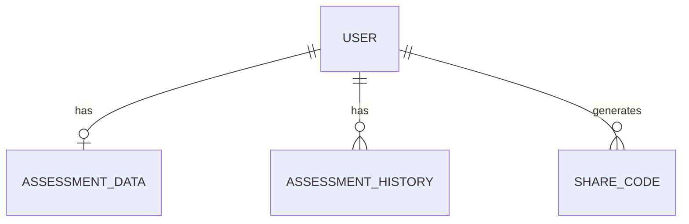
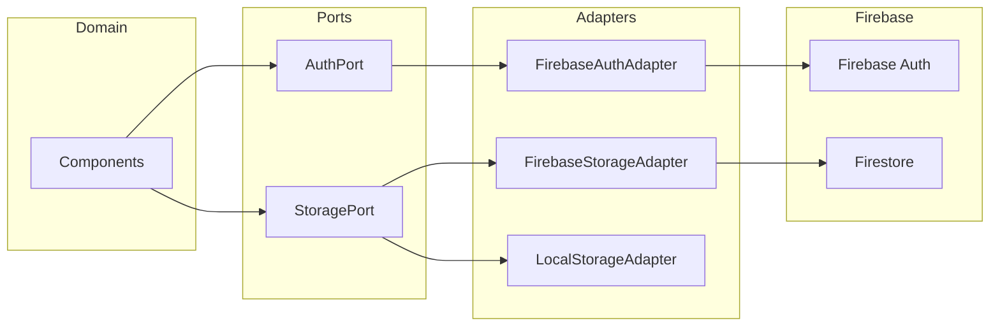

# SPEC-001: Firebase Auth & Assessment Storage

## 1. Meta

| Field | Value |
|---|---|
| Spec ID | SPEC-001 |
| Title | Firebase Auth & Assessment Storage |
| Track | full-triplet |
| Status | `approved` |
| Version | 1.0 |
| Owner | Viktor |
| Created | 2026-05-24 |
| Last updated | 2026-05-24 |
| Design | [2026-05-24-firebase-auth-storage-design.md](../../superpowers/specs/2026-05-24-firebase-auth-storage-design.md) |

## 2. Summary

Add Firebase authentication (Google, Email/Password, Anonymous) and cloud storage for assessment data. Users take the assessment anonymously, then are prompted to create a permanent account to save their results. Synastry partners share results via codes instead of file upload. Hexagonal ports/adapters architecture keeps Firebase swappable.

## 3. Business goal

- **Primary:** Persist assessment data in the cloud so users can return from any device without manual backup/export.
- **Secondary:** Enable synastry sharing via codes instead of file exchange.
- **Non-goals:** Admin dashboard, analytics, AI coach history persistence, payment/billing.

## 4. Context & background

- **Trigger:** All data currently in localStorage. Users lose results on device switch or clear.
- **Prior art:** localStorage-based persistence with JSON backup download/upload.
- **Decisions made:** Firebase Modular SDK (not AngularFire), hexagonal ports/adapters, anonymous-first auth flow.

## 5. Glossary

| Term | Definition |
|---|---|
| Port | TypeScript interface defining a contract (no implementation) |
| Adapter | Concrete class implementing a Port |
| Synastry | Comparison of two users' assessment results |
| Share code | 8-char random string allowing another user to read your assessment |
| Pantheon | Array of generated archetypes from assessment results |

## 6. Users & roles affected

- **Anonymous user:** Takes assessment, sees results. Prompted to sign up to persist data.
- **Authenticated user:** Full cloud persistence, history, synastry sharing.
- **Synastry partner:** Loads another user's results via share code.

## 7. User stories

### 7.1 Primary user stories

- **US-1:** As a new user, I want to take the assessment without creating an account, so I have zero friction.
- **US-2:** As a user who just received results, I want to sign up with Google or email to save my results permanently.
- **US-3:** As a returning user, I want my assessment data restored automatically when I sign in.
- **US-4:** As a user, I want to generate a share code so my partner can see my synastry results without sending a file.

### 7.2 Happy-path scenario

Alex opens the app. She takes the 52-question assessment anonymously. After results are generated, a prompt appears: "Save your results permanently?" She clicks "Sign in with Google." Her anonymous account is linked to her Google account. All data (responses, archetypes, dimensional expressions) is now in Firestore. Next week, she opens the app on her laptop, signs in, and her results are restored.

### 7.3 Edge-case scenarios

- **Scenario A — Offline during assessment:** User takes assessment while offline. Results are calculated via Gemini (which fails). On reconnect, retry works. Data saved to localStorage as fallback.
- **Scenario B — Sign-up after anonymous history:** User has multiple anonymous assessments in localStorage. On sign-up, only the latest is migrated to Firestore.
- **Scenario C — Share code used after owner retakes:** Share code still points to the assessment that existed when code was created. New assessment doesn't invalidate old share codes.

### 7.4 Error scenarios

| FR | Error condition | Expected behavior | User-facing message |
|---|---|---|---|
| FR-1 | Firebase unavailable on load | Sign in anonymously fails silently, proceed with localStorage | None (transparent) |
| FR-3 | Firestore write fails | Retry 3x, fall back to localStorage cache | None (transparent) |
| FR-5 | Share code not found | Show error | "This share code doesn't exist or has expired." |

## 8. Functional requirements

- **FR-1 MUST:** Anonymous sign-in on app load (transparent to user)
- **FR-2 MUST:** Google and Email/Password sign-up, linking anonymous account
- **FR-3 MUST:** Save assessment data (responses, results, dimensional expressions) to Firestore
- **FR-4 MUST:** Load assessment data on sign-in
- **FR-5 MUST:** Share code generation and loading for synastry
- **FR-6 MUST:** Fallback to localStorage when Firebase unavailable
- **FR-7 MUST:** Assessment history subcollection
- **FR-8 SHOULD:** Sign-up prompt after results are generated
- **FR-9 SHOULD:** Resilience (timeout, retry) on all Firebase calls

## 9. UX / Design

### 9.1 Screens & states

- **Sign-up prompt modal** — appears after results generated. States: default, loading, error.
- **Sign-in modal** — Google button + email/password form. States: default, loading, error, permission-denied.
- **Synastry panel (modified)** — adds share code input/generation alongside existing file upload.

### 9.2 User flows



### 9.3 Copy

All user-facing text goes through TranslationService (en + ru). Keys to add:

| Key | en | ru |
|---|---|---|
| `savePrompt.title` | Save Your Results | Сохранить результаты |
| `savePrompt.description` | Sign in to access your results from any device | Войдите, чтобы получить доступ к результатам с любого устройства |
| `savePrompt.google` | Sign in with Google | Войти через Google |
| `savePrompt.email` | Sign in with Email | Войти по Email |
| `savePrompt.skip` | Continue without saving | Продолжить без сохранения |
| `share.generate` | Generate Share Code | Создать код доступа |
| `share.enter` | Enter partner's code | Введите код партнёра |
| `share.notFound` | Share code not found | Код не найден |

## 10. Data model

### 10.1 Entities

- **AssessmentData** — responses, dimensional expressions, results, scoring method, timestamp
- **ShareCode** — maps random 8-char code to a user UID

### 10.2 Entity relationships



### 10.3 Firestore schema

```
users/{uid}
  assessment (document)
    responses: number[]
    dimensionalExpressions: object
    results: object
    scoringMethod: string
    updatedAt: timestamp

users/{uid}/history/{assessmentId}
    ...same + createdAt

shareCodes/{code}
    uid: string
    createdAt: timestamp
```

## 11. Architecture

### 11.1 Component diagram



### 11.2 Stack

| Layer | Technology | Rationale |
|---|---|---|
| Auth | Firebase Auth (modular SDK) | Supports Google, Email, Anonymous. Free tier sufficient. |
| Storage | Firestore | NoSQL fits assessment data shape. Real-time not needed but available. |
| Adapter pattern | TypeScript interfaces + DI | Swappable, testable, follows existing Angular patterns. |

## 12. Resilience

- **Timeout:** 10s per Firebase call via `Promise.race`
- **Retry:** 3x exponential backoff (100ms, 200ms, 400ms + jitter)
- **Fallback:** localStorage cache on failure

## 13. Security

- Firestore rules: users read/write own data only
- Share codes: publicly readable by authenticated users, writable only by owner
- Client-side only — no service account keys in the app

## 14. Testing

### 14.1 Test strategy

- **Unit tests:** Port interfaces, adapters with mocked Firebase, resilience helpers
- **Integration:** AuthService + FirebaseAuthAdapter against Firebase emulator
- **Manual:** Sign-in flow, data persistence, share code flow, offline behavior

## 15. Out of scope

- AI coach conversation persistence
- Admin dashboard
- Analytics/telemetry
- Payment/billing
- Account deletion UI
- Password reset flow

## 16. Traceability matrix

| User Story | Functional Req | Acceptance Criteria | Tasks |
|---|---|---|---|
| US-1 | FR-1 | AC-1 | T-001, T-004 |
| US-2 | FR-2, FR-3 | AC-2, AC-3 | T-002, T-004, T-005, T-006, T-007 |
| US-3 | FR-4 | AC-4 | T-005, T-006 |
| US-4 | FR-5 | AC-5 | T-005, T-008 |

## 17. Acceptance criteria

- **AC-1:** Given app loads / When no user signed in / Then anonymous sign-in happens transparently, assessment available immediately
- **AC-2:** Given results displayed / When user clicks sign-up / Then anonymous account links to chosen provider, data persists in Firestore
- **AC-3:** Given user signs in / When Firestore has saved data / Then assessment responses and results restored to app state
- **AC-4:** Given user generates share code / When partner enters code / Then partner's assessment data loads for synastry
- **AC-5:** Given Firebase unavailable / When save attempted / Then falls back to localStorage, no error shown to user
