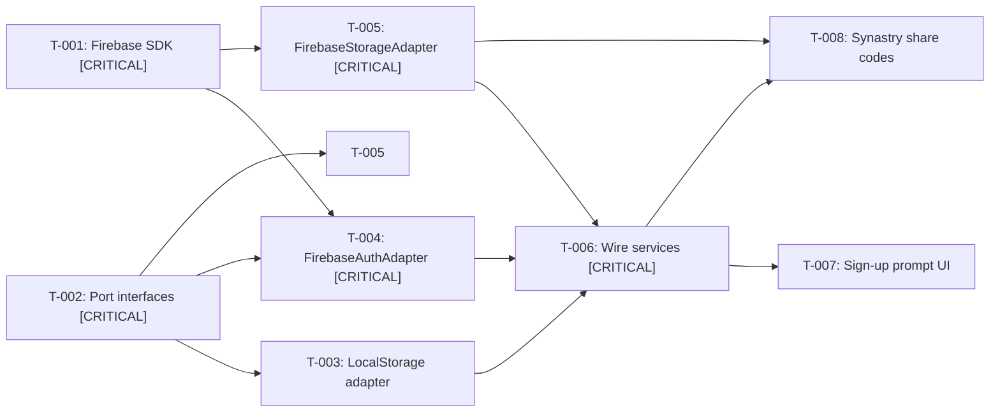

# SPEC-001 — Execution Plan

## 1. Meta

| Field | Value |
|---|---|
| Parent epic | [SPEC-001: Firebase Auth & Assessment Storage](./epic.md) |
| Tasks source | [tasks.md](./tasks.md) |
| Status | `not-started` |
| Concurrency cap | 3 |
| Created | 2026-05-24 |

## 2. Summary

- **Total tasks:** 8
- **Total waves:** 3
- **Critical path length:** 5 tasks (T-001 → T-002 → T-004 → T-005 → T-006)

Foundation tasks (T-001, T-002) have no dependencies and can run in parallel. After they complete, adapters (T-003, T-004, T-005) fan out in parallel. T-006 converges all adapters into the app. T-007 and T-008 are independent UI tasks that can run in parallel after T-006.

## 3. Dependency graph

## 4. Critical path

`T-001 [CRITICAL] → T-002 [CRITICAL] → T-004 [CRITICAL] → T-005 [CRITICAL] → T-006 [CRITICAL]` (length: 5)

## 5. Execution waves

### Wave 1

- **Tasks:** T-001, T-002
- **Parallel agents:** 2
- **Critical-path tasks:** both — fast-fail if either blocks
- **Integration tests:**
  1. `firebase` package installs, `firebase-init.ts` initializes without error
  2. Port interfaces compile and injection tokens are importable

### Wave 2

- **Tasks:** T-003, T-004, T-005
- **Blocked on:** Wave 1 complete
- **Parallel agents:** 3
- **Critical-path tasks:** T-004, T-005 — fast-fail if either blocks
- **Integration tests:**
  1. `FirebaseAuthAdapter.signInAnonymously()` resolves successfully
  2. `FirebaseStorageAdapter.saveAssessment()` + `loadAssessment()` round-trip
  3. `LocalStorageAdapter` matches existing localStorage behavior

### Wave 3

- **Tasks:** T-006, T-007, T-008
- **Blocked on:** Wave 2 complete
- **Parallel agents:** 3
- **Critical-path tasks:** T-006
- **Integration tests:**
  1. App loads → anonymous sign-in → assessment → save → reload → data restored
  2. Sign-up prompt appears for anonymous users after results
  3. Share code generation + loading works end-to-end

## 6. External dependencies

- **Packages to install:** `firebase` (latest modular SDK)
- **External services:** Firebase project (Auth + Firestore enabled)
- **Env vars:** None — config in environment.ts files

## 7. Review gates

| Gate | When | Status |
|---|---|---|
| Code review | End of Wave 3 | Manual — user triggers |
| Functional verification | Epic end | Manual — orchestrator surfaces checklist |

## 8. Failure policy

- Non-critical blocker (T-003 or T-007/T-008) → mark blocked, continue wave
- Critical-path blocker → fast-fail wave, propose re-plan
- >50% of wave blocked → treat as critical-path failure
